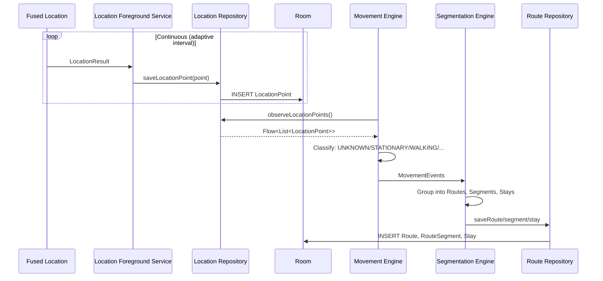
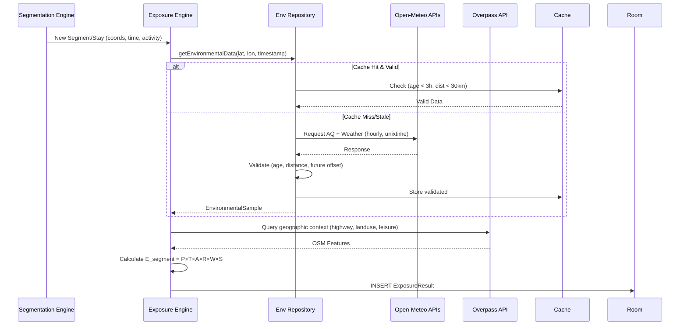
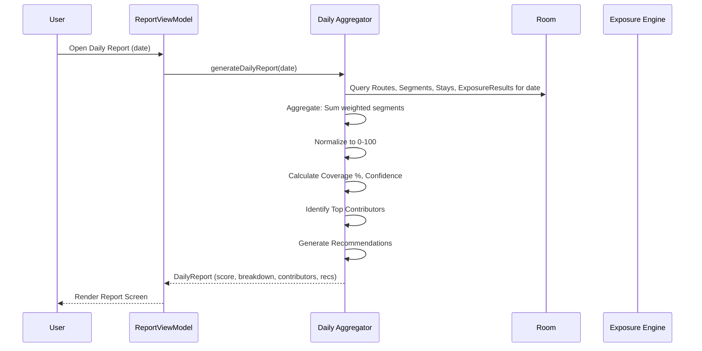
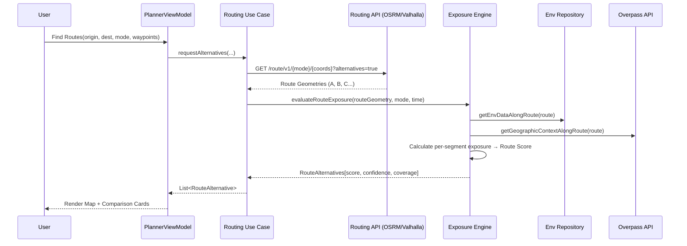

# System Architecture — Road Guide

## Overview

**Architectural Pattern**: MVVM + Repository + Clean Architecture layers
**Platform**: Android (Kotlin, Jetpack Compose)
**Async**: Kotlin Coroutines + Flow/StateFlow
**Local DB**: Room
**DI**: Hilt
**Background**: Foreground Service (location type)

---

## High-Level Architecture

```mermaid
graph TB
    subgraph "Android System"
        GPS[Fused Location Provider]
        AR[Activity Recognition]
        Sensors[Device Sensors]
        Notif[Notification Manager]
        Perm[Permission Manager]
    end

    subgraph "Road Guide App"
        subgraph "UI Layer (Compose)"
            MainScreen[Tracker Screen]
            TimelineScreen[Timeline Screen]
            PlannerScreen[Planner Screen]
            ReportScreen[Report Screen]
            SettingsScreen[Settings Screen]
            ViewModels[ViewModels + StateFlow]
        end

        subgraph "Domain Layer"
            TrackingUC[Tracking Use Cases]
            TimelineUC[Timeline Use Cases]
            ExposureUC[Exposure Use Cases]
            RoutingUC[Routing Use Cases]
            SettingsUC[Settings Use Cases]
        end

        subgraph "Data Layer"
            LocationRepo[Location Repository]
            EnvRepo[Environmental Repository]
            RouteRepo[Route Repository]
            PlaceRepo[Place Repository]
            SettingsRepo[Settings Repository]
            
            RoomDB[(Room Database)]
            DataStore[(DataStore Preferences)]
            Cache[(Memory/Disk Cache)]
        end

        subgraph "Background Services"
            LocationFS[Location Foreground Service]
            MovementEngine[Movement Detection Engine]
            SegmentationEngine[Route/Segment Engine]
            ExposureEngine[Exposure Calculation Engine]
            DailyAgg[Daily Aggregator]
        end

        subgraph "External Integrations"
            OpenMeteoWeather[Open-Meteo Weather API]
            OpenMeteoAQ[Open-Meteo Air Quality API]
            OverpassAPI[Overpass API / OSM]
            RoutingAPI[OSRM / Valhalla]
            MapTiles[OpenFreeMap Tiles]
        end
    end

    GPS --> LocationFS
    AR --> MovementEngine
    Sensors --> MovementEngine
    
    LocationFS --> LocationRepo
    LocationRepo --> RoomDB
    
    MovementEngine --> SegmentationEngine
    SegmentationEngine --> RouteRepo
    RouteRepo --> RoomDB
    
    SegmentationEngine --> ExposureEngine
    ExposureEngine --> EnvRepo
    EnvRepo --> OpenMeteoWeather
    EnvRepo --> OpenMeteoAQ
    EnvRepo --> Cache
    
    ExposureEngine --> OverpassAPI
    ExposureEngine --> DailyAgg
    DailyAgg --> RoomDB
    
    RoutingUC --> RoutingAPI
    RoutingAPI --> RoutingUC
    
    ViewModels --> TrackingUC
    ViewModels --> TimelineUC
    ViewModels --> ExposureUC
    ViewModels --> RoutingUC
    ViewModels --> SettingsUC
    
    TrackingUC --> LocationRepo
    TrackingUC --> RouteRepo
    TimelineUC --> RouteRepo
    TimelineUC --> PlaceRepo
    ExposureUC --> ExposureEngine
    ExposureUC --> DailyAgg
    RoutingUC --> RouteRepo
    RoutingUC --> EnvRepo
    
    SettingsUC --> SettingsRepo
    SettingsRepo --> DataStore
    
    MainScreen --> ViewModels
    TimelineScreen --> ViewModels
    PlannerScreen --> ViewModels
    ReportScreen --> ViewModels
    SettingsScreen --> ViewModels
    
    LocationFS --> Notif
    Perm -.-> LocationFS
```



---

## Architectural Layers

### 1. UI Layer (Jetpack Compose)
- **Screens**: Composable functions, stateless where possible
- **ViewModels**: Hold `StateFlow`/`MutableStateFlow`, expose UI state
- **Navigation**: Compose Navigation (bottom nav + profile/settings via top bar)
- **Map**: MapLibre Compose integration, full-screen background on Tracker

### 2. Domain Layer (Use Cases)
- Single-responsibility suspend functions
- Orchestrate repositories and engines
- No Android framework dependencies
- Testable with standard JUnit

### 3. Data Layer (Repositories)
- **LocationRepository**: GPS points, raw storage, queries
- **EnvironmentalRepository**: AQ/Weather fetch, validation, caching
- **RouteRepository**: Routes, segments, stays, places
- **PlaceRepository**: User places, categories, privacy
- **SettingsRepository**: DataStore preferences, tracking config

### 4. Background Engines (Domain Services)
- **MovementDetectionEngine**: Classifies GPS sequences → Activity states
- **RouteSegmentationEngine**: Groups points → Routes, Segments, Stays
- **GeographicContextEngine**: Overpass queries → road type, green areas, industrial
- **ExposureCalculationEngine**: Segment-level E = P×T×A×R×W×S
- **DailyExposureAggregator**: Sums segments → Daily Score 0–100 + Confidence + Coverage

---

## Core Data Flows

### GPS Data Flow



### Environmental Data Flow



### Daily Report Flow



### Eco Route Planner Flow



---

## Module/Package Structure (Planned)

```
com.roadguide
├── app/
│   ├── MainActivity.kt
│   ├── Navigation/
│   │   ├── AppNavHost.kt
│   │   ├── BottomNavBar.kt
│   │   └── AppDestinations.kt
│   └── di/ (Hilt modules)
├── core/
│   ├── common/ (Result, UseCase, extensions)
│   ├── data/ (Repository interfaces)
│   ├── domain/
│   │   ├── model/ (Domain entities)
│   │   ├── usecase/ (Tracking, Timeline, Exposure, Routing, Settings)
│   │   └── engine/
│   │       ├── MovementDetectionEngine.kt
│   │       ├── RouteSegmentationEngine.kt
│   │       ├── GeographicContextEngine.kt
│   │       ├── ExposureCalculationEngine.kt
│   │       └── DailyExposureAggregator.kt
│   └── util/ (Date, Math, Geo helpers)
├── data/
│   ├── local/
│   │   ├── RoomDatabase.kt
│   │   ├── dao/
│   │   ├── entity/
│   │   └── converter/
│   ├── remote/
│   │   ├── openmeteo/
│   │   ├── overpass/
│   │   └── routing/
│   ├── repository/
│   │   ├── LocationRepositoryImpl.kt
│   │   ├── EnvironmentalRepositoryImpl.kt
│   │   ├── RouteRepositoryImpl.kt
│   │   ├── PlaceRepositoryImpl.kt
│   │   └── SettingsRepositoryImpl.kt
│   └── cache/
├── feature/
│   ├── tracker/
│   │   ├── TrackerScreen.kt
│   │   ├── TrackerViewModel.kt
│   │   ├── BottomSheet/
│   │   │   ├── TodayOverviewCard.kt
│   │   │   ├── DailyExposureCard.kt
│   │   │   ├── CurrentEnvironmentCard.kt
│   │   │   ├── RecentActivityCard.kt
│   │   │   ├── TimelineAccessCard.kt
│   │   │   └── QuickActionsCard.kt
│   │   └── Map/
│   ├── timeline/
│   ├── planner/
│   ├── report/
│   ├── places/
│   ├── history/
│   ├── settings/
│   ├── onboarding/
│   └── profile/
├── service/
│   ├── TrackingRecordingService.kt
│   ├── TrackingNotification.kt
│   └── BootReceiver.kt
└── map/
    ├── MapLibreIntegration.kt
    ├── MapStyle.kt
    └── MapOverlays.kt
```

---

## Key Component Responsibilities

| Component | Responsibility | Key Methods |
|-----------|----------------|-------------|
| `TrackingRecordingService` | Continuous GPS collection, route lifecycle, segmentation, notification | `onStartCommand`, location callbacks, pause/resume/stop |
| `MovementDetectionEngine` | Classify point sequences → Activity state | `classifyMovement(points)`, `detectStay(points)` |
| `RouteSegmentationEngine` | Build Routes, Segments, Stays from classified points | `segmentRoute(points)`, `mergeShortStops()`, `finalizeRoute()` |
| `GeographicContextEngine` | Query OSM for road type, green areas, industrial | `getContext(lat, lon, radius)`, `classifyRoadType(way)` |
| `ExposureCalculationEngine` | Calculate E_segment = P×T×A×R×W×S | `calculateSegmentExposure(segment, env, context)` |
| `DailyExposureAggregator` | Aggregate segments → Daily Score 0–100 | `aggregateDaily(date)`, `normalize(raw)`, `topContributors()` |
| `EnvironmentalRepository` | Fetch, validate, cache AQ + Weather | `getEnvironmentalData(coord, time)`, `validate(sample)` |
| `RoutingRepository` | Request alternatives, enrich with exposure | `getAlternatives(origin, dest, mode)`, `enrichWithExposure(routes)` |

---

## Persistence Strategy

| Data | Storage | Retention |
|------|---------|-----------|
| LocationPoint | Room | Configurable (default 90 days) |
| Route / Segment / Stay | Room | Configurable |
| Place | Room | Until user deletes |
| EnvironmentalSample | Room (cache) | 3 hours (max age per validator) |
| ExposureResult | Room | With parent Route/Stay |
| DailyReport | Room | Indefinite (user history) |
| UserSettings | DataStore | Until changed |
| Private Zones | Room | Until user removes |

---

## Background Execution Model

```
┌─────────────────────────────────────────────────────────────┐
│                   Foreground Service                        │
│  Type: location  │  Notification: Ongoing tracking          │
├─────────────────────────────────────────────────────────────┤
│  Lifecycle:                                                 │
│  1. User enables Auto Tracking → startForeground()         │
│  2. Request location updates (adaptive interval)           │
│  3. On location → save to Room via Repository              │
│  4. Movement Engine consumes points → classifies           │
│  5. Segmentation Engine builds routes/stays                │
│  6. Exposure Engine enriches + calculates                  │
│  7. On app kill/OS restart → BOOT_COMPLETED → restart      │
│  8. User pauses → stopForeground() + stop location updates │
└─────────────────────────────────────────────────────────────┘
```

**Adaptive Intervals** (per spec, to be tuned on device):
- Active movement: ~5–10 sec
- Slow movement: ~15–30 sec
- Stationary: ~60–300 sec
- GPS lost: retain last known, flag uncertainty

---

## Error Handling & Resilience

| Failure Point | Strategy |
|---------------|----------|
| GPS unavailable | Retain last known, mark uncertainty, continue when restored |
| Network timeout (env API) | Use cached data if < 3h old, else mark incomplete |
| Overpass API down | Skip geographic context, reduce Confidence |
| Routing API fails | Show cached/error state, allow retry |
| Process death | Foreground Service restarts via `START_STICKY` + BootReceiver |
| DB migration failure | Fallback to destructive migration (dev) / proper migration (prod) |

---

## Planned vs Implemented Status

> The repository contains implemented infrastructure, domain engines, repositories, Compose screens, and test suites. Status is mixed: foundational components are implemented or partially implemented, while complete user flows, migrations, device recovery validation, export, and some integrations remain incomplete. Use `13_CURRENT_IMPLEMENTATION_STATUS.md` for component-level status.
> This document defines the target architecture per `ROAD GUIDE.txt` specification.