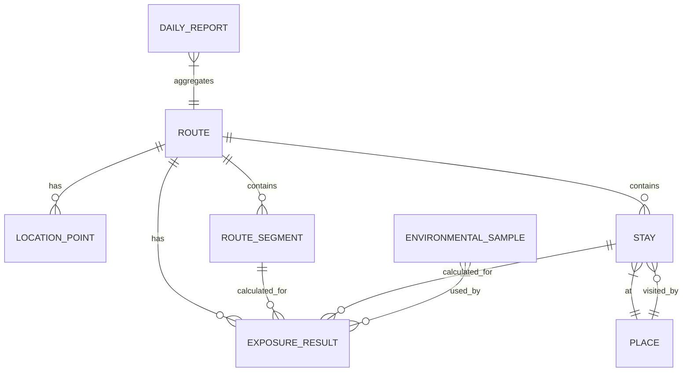

# Data Model & Database — Road Guide

## Database: Room

**Database Name**: `RoadGuideDatabase`
**Version**: 1 (initial)
**Migration Strategy**: Incremental versioned migrations; fallback destructive for dev

---

## Entities

### 1. LocationPoint
Raw GPS points from Foreground Service.

```kotlin
@Entity(
    tableName = "location_points",
    indices = [
        Index(value = ["timestamp"]),
        Index(value = ["routeId"]),
    ]
)
data class LocationPoint(
    @PrimaryKey(autoGenerate = true) val id: Long = 0,
    val latitude: Double,
    val longitude: Double,
    val timestamp: Long,                    // Unix milliseconds (UTC)
    val accuracyMeters: Float,
    val speedMetersPerSecond: Float?,
    val bearing: Float?,                    // Degrees 0-360
    val altitude: Double?,                  // Meters above WGS84 ellipsoid
    val provider: String,                   // "gps", "network", "fused", "passive"
    val isMock: Boolean = false,
    val qualityFlags: Int = 0,              // Bitmask: 1=low_accuracy, 2=mock, 4=jump_detected, 8=stale
    val routeId: Long? = null,              // FK to Route (nullable until segmented)
    val collectionDiagnostics: String? = null // JSON: battery, interval, source
)
```

**Quality Flags Bitmask**:
| Bit | Value | Meaning |
|-----|-------|---------|
| 0 | 1 | Low accuracy (>50m) |
| 1 | 2 | Mock location detected |
| 2 | 4 | GPS jump detected (speed implausible) |
| 3 | 8 | Stale data (older than expected interval) |

---

### 2. Route
A continuous tracking session (typically one day, but can span midnight).

```kotlin
@Entity(
    tableName = "routes",
    indices = [Index(value = ["startTime"]), Index(value = ["date"])]
)
data class Route(
    @PrimaryKey(autoGenerate = true) val id: Long = 0,
    val startTime: Long,                    // Unix ms (local timezone)
    val endTime: Long?,                     // Null if still active
    val distanceMeters: Double = 0.0,
    val status: RouteStatus = RouteStatus.IN_PROGRESS,
    val routeType: RouteType = RouteType.DAILY_AUTO,
    val confidence: Double = 0.0,           // 0.0–1.0 overall route confidence
    val date: String,                       // YYYY-MM-DD (local date of startTime)
    val totalDurationSeconds: Long = 0,
    val calculationVersion: Int = 1         // Exposure model version used
)

enum class RouteStatus { IN_PROGRESS, COMPLETED, PAUSED, CORRUPTED }
enum class RouteType { DAILY_AUTO, MANUAL_TRACKING, PLANNED_ROUTE }
```

---

### 3. RouteSegment
A homogeneous movement segment within a Route.

```kotlin
@Entity(
    tableName = "route_segments",
    indices = [
        Index(value = ["routeId"]),
        Index(value = ["startTime"]),
        Index(value = ["activityType"]),
    ],
    foreignKeys = [ForeignKey(
        entity = Route::class,
        parentColumns = ["id"],
        childColumns = ["routeId"],
        onDelete = ForeignKey.CASCADE
    )]
)
data class RouteSegment(
    @PrimaryKey(autoGenerate = true) val id: Long = 0,
    val routeId: Long,
    val startTime: Long,                    // Unix ms
    val endTime: Long,
    val activityType: ActivityType,
    val transportType: TransportType?,
    val distanceMeters: Double,
    val startLatitude: Double,
    val startLongitude: Double,
    val endLatitude: Double,
    val endLongitude: Double,
    val geometryReference: String?,         // Encoded polyline or FK to geometry table
    val confidence: Double = 0.0,           // 0.0–1.0 classification confidence
    val isUserCorrected: Boolean = false,
    val correctedActivityType: ActivityType? = null,
    val correctedTransportType: TransportType? = null
)

enum class ActivityType { UNKNOWN, STATIONARY, WALKING, RUNNING, CYCLING, IN_VEHICLE, PUBLIC_TRANSPORT }
enum class TransportType { NONE, WALKING, CYCLING, CAR, MOTORCYCLE, BUS, TRAM, TRAIN, SUBWAY, FERRY, OTHER }
```

---

### 4. Stay
A stationary period (place visit).

```kotlin
@Entity(
    tableName = "stays",
    indices = [
        Index(value = ["routeId"]),
        Index(value = ["startTime"]),
        Index(value = ["placeId"]),
    ],
    foreignKeys = [
        ForeignKey(entity = Route::class, parentColumns = ["id"], childColumns = ["routeId"], onDelete = ForeignKey.CASCADE),
        ForeignKey(entity = Place::class, parentColumns = ["id"], childColumns = ["placeId"], onDelete = ForeignKey.SET_NULL)
    ]
)
data class Stay(
    @PrimaryKey(autoGenerate = true) val id: Long = 0,
    val routeId: Long,
    val startTime: Long,
    val endTime: Long,
    val centerLatitude: Double,
    val centerLongitude: Double,
    val radiusMeters: Double,
    val placeId: Long? = null,
    val confidence: Double = 0.0,
    val locationLabel: String? = null,      // "Home", "Work", "Coffee Shop", etc.
    val privacyStatus: PrivacyStatus = PrivacyStatus.PUBLIC,
    val isIndoor: Boolean = false,
    val indoorConfidence: Double = 0.0
)

enum class PrivacyStatus { PUBLIC, PRIVATE, EXCLUDED }
```

---

### 5. Place
User-identified or frequently visited location.

```kotlin
@Entity(
    tableName = "places",
    indices = [Index(value = ["category"]), Index(value = ["isPrivate"])]
)
data class Place(
    @PrimaryKey(autoGenerate = true) val id: Long = 0,
    val name: String,
    val category: PlaceCategory = PlaceCategory.OTHER,
    val latitude: Double,
    val longitude: Double,
    val radiusMeters: Double = 100.0,
    val address: String? = null,
    val isPrivate: Boolean = false,
    val userLabel: String? = null,          // User custom name
    val visitCount: Int = 0,
    val totalDurationSeconds: Long = 0,
    val firstVisitTime: Long = 0,
    val lastVisitTime: Long = 0,
    val environmentalStats: String? = null  // JSON: avg AQI, exposure stats
)

enum class PlaceCategory { HOME, WORK, SCHOOL, GYM, PARK, SHOP, RESTAURANT, TRANSIT, OTHER }
```

---

### 6. EnvironmentalSample
Cached environmental data (Air Quality + Weather) for a coordinate/time.

```kotlin
@Entity(
    tableName = "environmental_samples",
    indices = [
        Index(value = ["timestamp"]),
        Index(value = ["latitude", "longitude"]),
        Index(value = ["source"]),
    ]
)
data class EnvironmentalSample(
    @PrimaryKey(autoGenerate = true) val id: Long = 0,
    val latitude: Double,
    val longitude: Double,
    val timestamp: Long,                    // Unix ms (data valid for this hour)
    // Air Quality (μg/m³ unless noted)
    val pm2_5: Double?,
    val pm10: Double?,
    val nitrogenDioxide: Double?,
    val ozone: Double?,
    val sulphurDioxide: Double?,
    val carbonMonoxide: Double?,
    val usAqi: Int?,                        // US AQI (0-500+)
    val europeanAqi: Int?,                  // European AQI (0-100+)
    // Weather
    val temperatureCelsius: Double?,
    val apparentTemperatureCelsius: Double?,
    val relativeHumidityPercent: Double?,
    val windSpeedMs: Double?,
    val windDirectionDegrees: Double?,
    val precipitationMm: Double?,
    val rainMm: Double?,
    val cloudCoverPercent: Double?,
    val uvIndex: Double?,
    // Metadata
    val source: DataSource = DataSource.OPEN_METEO,
    val dataQuality: DataQuality = DataQuality.UNKNOWN,
    val modelResolutionKm: Double?,         // e.g., 11.0 (EU), 45.0 (global)
    val fetchedAt: Long = System.currentTimeMillis()
)

enum class DataSource { OPEN_METEO, OPEN_METEO_AQ, OVERPASS, MANUAL }
enum class DataQuality { HIGH, MEDIUM, LOW, UNKNOWN, STALE, OUT_OF_RANGE }
```

**Validation Rules (per spec)**:
- Max age: **3 hours** → else `STALE`
- Max coordinate distance: **30 km** → else `OUT_OF_RANGE`
- Max future timestamp offset: **15 minutes** → else `OUT_OF_RANGE`
- Failed validation → `DataQuality` downgraded, Confidence reduced, never treated as zero pollution

---

### 7. ExposureResult
Calculated exposure for a Segment or Stay.

```kotlin
@Entity(
    tableName = "exposure_results",
    indices = [
        Index(value = ["routeId"]),
        Index(value = ["segmentId"]),
        Index(value = ["stayId"]),
        Index(value = ["calculationVersion"]),
    ],
    foreignKeys = [
        ForeignKey(entity = Route::class, parentColumns = ["id"], childColumns = ["routeId"], onDelete = ForeignKey.CASCADE),
        ForeignKey(entity = RouteSegment::class, parentColumns = ["id"], childColumns = ["segmentId"], onDelete = ForeignKey.CASCADE),
        ForeignKey(entity = Stay::class, parentColumns = ["id"], childColumns = ["stayId"], onDelete = ForeignKey.CASCADE)
    ]
)
data class ExposureResult(
    @PrimaryKey(autoGenerate = true) val id: Long = 0,
    val routeId: Long,
    val segmentId: Long? = null,
    val stayId: Long? = null,
    val score: Double,                      // Raw segment score (pre-normalization)
    val normalizedScore: Double,            // 0–100 after daily normalization
    val confidence: Double,                 // 0.0–1.0
    val coverage: Double,                   // 0.0–1.0 (data coverage for this segment)
    // Factor breakdown (for explainability)
    val pollutionFactor: Double,
    val timeFactor: Double,
    val activityFactor: Double,
    val roadFactor: Double,
    val weatherFactor: Double,
    val skinFactor: Double,
    val calculationVersion: Int,
    val createdAt: Long = System.currentTimeMillis()
)
```

---

### 8. DailyReport
Aggregated daily exposure summary.

```kotlin
@Entity(tableName = "daily_reports", indices = [Index(value = ["date"], unique = true)])
data class DailyReport(
    @PrimaryKey val date: String,           // YYYY-MM-DD (local)
    val totalScore: Double,                 // 0–100 normalized
    val confidence: Double,                 // 0.0–1.0
    val coverage: Double,                   // 0.0–1.0
    val totalDistanceMeters: Double,
    val totalDurationSeconds: Long,
    val walkingDurationSeconds: Long,
    val transportDurationSeconds: Long,
    val stationaryDurationSeconds: Long,
    val visitedPlacesCount: Int,
    val topContributorsJson: String,        // List of TopContributor
    val bestPeriodJson: String?,            // TimePeriod
    val worstPeriodJson: String?,           // TimePeriod
    val recommendationsJson: String,        // List of Recommendation
    val reportVersion: Int = 1,
    val generatedAt: Long = System.currentTimeMillis(),
    val isRegenerated: Boolean = false      // True if recalculated after late env data
)

data class TopContributor(
    val startTime: Long,
    val endTime: Long,
    val label: String,                      // "Public transport near major road"
    val contributionLevel: ContributionLevel,
    val segmentId: Long?,
    val stayId: Long?
)

enum class ContributionLevel { HIGH, MEDIUM, LOW }

data class TimePeriod(
    val startTime: Long,
    val endTime: Long,
    val label: String,
    val score: Double
)

data class Recommendation(
    val type: RecommendationType,
    val title: String,
    val description: String,
    val relatedSegmentId: Long?
)

enum class RecommendationType { ROUTE_ALTERNATIVE, TIMING_SHIFT, MODE_SHIFT, INDOOR_ACTIVITY, GENERAL }
```

---

### 9. UserSettings
App preferences (DataStore + Room for complex objects).

```kotlin
// DataStore (Preferences) - simple key-values
// tracking_enabled: Boolean
// tracking_schedule_start: Long (minutes from midnight)
// tracking_schedule_end: Long
// location_accuracy: String ("high", "balanced", "low")
// battery_optimization: Boolean
// activity_detection_enabled: Boolean
// background_monitoring_enabled: Boolean
// aqi_standard: String ("US", "EU")
// distance_unit: String ("km", "mi")
// temperature_unit: String ("C", "F")
// time_format: String ("24h", "12h")
// language: String ("en")
// notifications_*: Boolean (daily_report, tracking_status, data_warnings, route_suggestions, env_alerts)
// map_style: String
// map_show_green_areas: Boolean
// map_show_major_roads: Boolean
// map_show_exposure_overlay: Boolean
// map_show_timeline_points: Boolean
// map_show_private_zones: Boolean (default false)

// Room - complex objects
@Entity(tableName = "privacy_zones", indices = [Index(value = ["name"])])
data class PrivacyZone(
    @PrimaryKey(autoGenerate = true) val id: Long = 0,
    val name: String,
    val centerLatitude: Double,
    val centerLongitude: Double,
    val radiusMeters: Double,
    val isActive: Boolean = true,
    val excludeFromHistory: Boolean = true,
    val excludeFromExposure: Boolean = false,
    val createdAt: Long = System.currentTimeMillis()
)

@Entity(tableName = "data_retention_policy")
data class DataRetentionPolicy(
    @PrimaryKey val key: String = "default", // single row
    val locationPointsDays: Int = 90,
    val routesDays: Int = 365,
    val environmentalSamplesHours: Int = 72,
    val exposureResultsDays: Int = 365,
    val dailyReportsDays: Int = -1,         // -1 = forever
    val autoDeleteEnabled: Boolean = true
)
```

---

## Entity Relationships



---

## DAO Interfaces (Key Methods)

```kotlin
@Dao
interface LocationPointDao {
    @Insert(onConflict = OnConflictStrategy.IGNORE)
    suspend fun insertAll(points: List<LocationPoint>): List<Long>
    
    @Query("SELECT * FROM location_points WHERE routeId = :routeId ORDER BY timestamp")
    fun getByRouteId(routeId: Long): Flow<List<LocationPoint>>
    
    @Query("SELECT * FROM location_points WHERE timestamp BETWEEN :start AND :end ORDER BY timestamp")
    fun getByTimeRange(start: Long, end: Long): Flow<List<LocationPoint>>
    
    @Query("DELETE FROM location_points WHERE timestamp < :cutoff")
    suspend fun deleteOlderThan(cutoff: Long): Int
    
    @Query("UPDATE location_points SET routeId = :routeId WHERE id IN (:pointIds)")
    suspend fun assignToRoute(pointIds: List<Long>, routeId: Long)
}

@Dao
interface RouteDao {
    @Insert(onConflict = OnConflictStrategy.IGNORE)
    suspend fun insert(route: Route): Long
    
    @Query("SELECT * FROM routes WHERE id = :id")
    fun getById(id: Long): Flow<Route?>
    
    @Query("SELECT * FROM routes WHERE date = :date")
    fun getByDate(date: String): Flow<Route?>
    
    @Query("SELECT * FROM routes WHERE status = :status ORDER BY startTime DESC")
    fun getByStatus(status: RouteStatus): Flow<List<Route>>
    
    @Query("SELECT * FROM routes ORDER BY startTime DESC LIMIT :limit")
    fun getRecent(limit: Int): Flow<List<Route>>
    
    @Update
    suspend fun update(route: Route)
}

@Dao
interface RouteSegmentDao {
    @Insert
    suspend fun insertAll(segments: List<RouteSegment>): List<Long>
    
    @Query("SELECT * FROM route_segments WHERE routeId = :routeId ORDER BY startTime")
    fun getByRouteId(routeId: Long): Flow<List<RouteSegment>>
    
    @Query("SELECT * FROM route_segments WHERE id = :id")
    fun getById(id: Long): Flow<RouteSegment?>
    
    @Update
    suspend fun update(segment: RouteSegment)
}

@Dao
interface StayDao {
    @Insert
    suspend fun insert(stay: Stay): Long
    
    @Query("SELECT * FROM stays WHERE routeId = :routeId ORDER BY startTime")
    fun getByRouteId(routeId: Long): Flow<List<Stay>>
    
    @Query("SELECT * FROM stays WHERE placeId = :placeId ORDER BY startTime DESC")
    fun getByPlaceId(placeId: Long): Flow<List<Stay>>
}

@Dao
interface PlaceDao {
    @Insert(onConflict = OnConflictStrategy.REPLACE)
    suspend fun insert(place: Place): Long
    
    @Query("SELECT * FROM places WHERE id = :id")
    fun getById(id: Long): Flow<Place?>
    
    @Query("SELECT * FROM places WHERE category = :category")
    fun getByCategory(category: PlaceCategory): Flow<List<Place>>
    
    @Query("SELECT * FROM places WHERE isPrivate = 0 ORDER BY visitCount DESC")
    fun getPublicPlaces(): Flow<List<Place>>
    
    @Update
    suspend fun update(place: Place)
}

@Dao
interface EnvironmentalSampleDao {
    @Insert(onConflict = OnConflictStrategy.REPLACE)
    suspend fun insert(sample: EnvironmentalSample): Long
    
    @Query("""
        SELECT * FROM environmental_samples 
        WHERE latitude BETWEEN :lat - :delta AND :lat + :delta
        AND longitude BETWEEN :lon - :delta AND :lon + :delta
        AND timestamp BETWEEN :time - :window AND :time + :window
        AND dataQuality != 'OUT_OF_RANGE'
        ORDER BY ABS(latitude - :lat) + ABS(longitude - :lon) + ABS(timestamp - :time)
        LIMIT 1
    """)
    fun findNearest(lat: Double, lon: Double, time: Long, delta: Double, window: Long): Flow<EnvironmentalSample?>
    
    @Query("DELETE FROM environmental_samples WHERE fetchedAt < :cutoff")
    suspend fun deleteOlderThan(cutoff: Long): Int
}

@Dao
interface ExposureResultDao {
    @Insert
    suspend fun insertAll(results: List<ExposureResult>): List<Long>
    
    @Query("SELECT * FROM exposure_results WHERE routeId = :routeId")
    fun getByRouteId(routeId: Long): Flow<List<ExposureResult>>
    
    @Query("SELECT * FROM exposure_results WHERE segmentId = :segmentId")
    fun getBySegmentId(segmentId: Long): Flow<ExposureResult?>
    
    @Query("SELECT * FROM exposure_results WHERE stayId = :stayId")
    fun getByStayId(stayId: Long): Flow<ExposureResult?>
}

@Dao
interface DailyReportDao {
    @Insert(onConflict = OnConflictStrategy.REPLACE)
    suspend fun insert(report: DailyReport): Long
    
    @Query("SELECT * FROM daily_reports WHERE date = :date")
    fun getByDate(date: String): Flow<DailyReport?>
    
    @Query("SELECT * FROM daily_reports ORDER BY date DESC LIMIT :limit")
    fun getRecent(limit: Int): Flow<List<DailyReport>>
    
    @Query("SELECT * FROM daily_reports WHERE date BETWEEN :start AND :end ORDER BY date DESC")
    fun getByDateRange(start: String, end: String): Flow<List<DailyReport>>
}

@Dao
interface PrivacyZoneDao {
    @Insert
    suspend fun insert(zone: PrivacyZone): Long
    
    @Query("SELECT * FROM privacy_zones WHERE isActive = 1")
    fun getActiveZones(): Flow<List<PrivacyZone>>
    
    @Delete
    suspend fun delete(zone: PrivacyZone)
}
```

---

## Repository Pattern

Each Repository:
- Single source of truth for its domain
- Combines Room DAOs + Remote APIs + Cache
- Exposes `Flow` for reactive UI
- Handles offline-first, sync, conflict resolution

```kotlin
interface LocationRepository {
    fun observeLocationPoints(routeId: Long): Flow<List<LocationPoint>>
    fun observeRecentPoints(limit: Int): Flow<List<LocationPoint>>
    suspend fun savePoints(points: List<LocationPoint>)
    suspend fun assignPointsToRoute(pointIds: List<Long>, routeId: Long)
    suspend fun cleanupOldPoints(olderThanDays: Int)
}

interface RouteRepository {
    fun observeRoute(routeId: Long): Flow<Route?>
    fun observeRoutesByDate(date: String): Flow<Route?>
    fun observeRecentRoutes(limit: Int): Flow<List<Route>>
    suspend fun createRoute(route: Route): Long
    suspend fun updateRoute(route: Route)
    suspend fun completeRoute(routeId: Long, endTime: Long)
    // Segments & Stays
    suspend fun saveSegments(segments: List<RouteSegment>)
    suspend fun saveStays(stays: List<Stay>)
    fun observeSegments(routeId: Long): Flow<List<RouteSegment>>
    fun observeStays(routeId: Long): Flow<List<Stay>>
}

interface EnvironmentalRepository {
    suspend fun getEnvironmentalData(lat: Double, lon: Double, timestamp: Long): EnvironmentalSample
    suspend fun prefetchForRoute(routeGeometry: List<LatLng>, timestamp: Long)
    fun observeSample(lat: Double, lon: Double, time: Long): Flow<EnvironmentalSample?>
    suspend fun invalidateCache(olderThanHours: Int)
}

interface ExposureRepository {
    suspend fun calculateSegmentExposure(segment: RouteSegment, env: EnvironmentalSample, context: GeographicContext): ExposureResult
    suspend fun calculateStayExposure(stay: Stay, env: EnvironmentalSample, context: GeographicContext): ExposureResult
    fun observeExposureResults(routeId: Long): Flow<List<ExposureResult>>
}

interface DailyReportRepository {
    suspend fun generateReport(date: String): DailyReport
    suspend fun regenerateReport(date: String): DailyReport  // for late-arriving env data
    fun observeReport(date: String): Flow<DailyReport?>
    fun observeRecentReports(limit: Int): Flow<List<DailyReport>>
}
```

---

## Migrations

```kotlin
// Version 1 → 2 example: Add indoorConfidence to Stay
val MIGRATION_1_2 = object : Migration(1, 2) {
    override fun migrate(database: SupportSQLiteDatabase) {
        database.execSQL("ALTER TABLE stays ADD COLUMN indoorConfidence REAL NOT NULL DEFAULT 0.0")
    }
}

// Version 2 → 3: Add calculationVersion to ExposureResult
val MIGRATION_2_3 = object : Migration(2, 3) {
    override fun migrate(database: SupportSQLiteDatabase) {
        database.execSQL("ALTER TABLE exposure_results ADD COLUMN calculationVersion INTEGER NOT NULL DEFAULT 1")
    }
}

@Database(
    entities = [
        LocationPoint::class,
        Route::class,
        RouteSegment::class,
        Stay::class,
        Place::class,
        EnvironmentalSample::class,
        ExposureResult::class,
        DailyReport::class,
        PrivacyZone::class,
        DataRetentionPolicy::class
    ],
    version = 1, // Increment with each migration
    exportSchema = true
)
abstract class RoadGuideDatabase : RoomDatabase() {
    abstract fun locationPointDao(): LocationPointDao
    abstract fun routeDao(): RouteDao
    abstract fun routeSegmentDao(): RouteSegmentDao
    abstract fun stayDao(): StayDao
    abstract fun placeDao(): PlaceDao
    abstract fun environmentalSampleDao(): EnvironmentalSampleDao
    abstract fun exposureResultDao(): ExposureResultDao
    abstract fun dailyReportDao(): DailyReportDao
    abstract fun privacyZoneDao(): PrivacyZoneDao
    
    companion object {
        @Volatile private var INSTANCE: RoadGuideDatabase? = null
        
        fun getInstance(context: Context): RoadGuideDatabase {
            return INSTANCE ?: synchronized(this) {
                INSTANCE ?: Room.databaseBuilder(
                    context.applicationContext,
                    RoadGuideDatabase::class.java,
                    "road_guide.db"
                ).addMigrations(MIGRATION_1_2, MIGRATION_2_3) // Add as needed
                    .fallbackToDestructiveMigration() // Dev only; remove for prod
                    .build().also { INSTANCE = it }
            }
        }
    }
}
```

---

## Planned vs Implemented

> **All entities and DAOs are 📋 Planned** — no Room database exists in codebase yet.
> This document defines the target schema per `ROAD GUIDE.txt` specification (Part 13).