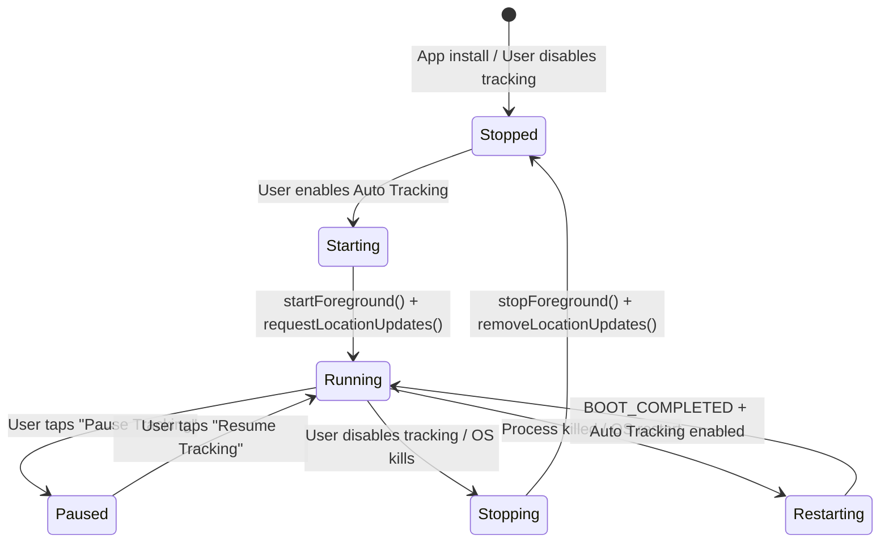
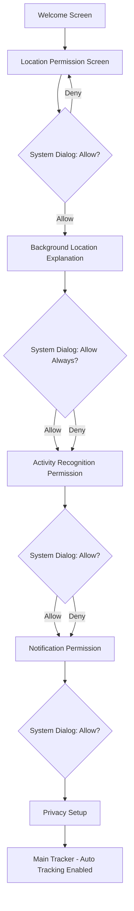

# GPS & Tracking — Road Guide

## Overview

Continuous, automatic background location monitoring is the foundation of Road Guide. The system collects GPS points via a Foreground Service, classifies movement, segments into routes/stays, and enriches with environmental data.

**Status**: 🟡 Partially implemented. The app now starts, pauses, resumes, and stops a
location foreground service; persistent route IDs, staged permission requests, and
boot recovery are implemented. On route completion, saved location points are
classified and segmented into activity periods and sustained stays; route distance
ignores GPS gaps longer than five minutes. Timeline observes routes, segments, and
stays as live database flows. Other detailed sections below remain target design
where they describe features not yet present in code.

**Current implementation**: `TrackingRecordingService`, `TrackingServiceController`,
`LocationSource`, `PermissionSource`, and `BootReceiver`. Tracking requires foreground
and background location permission on Android 10+; Android notification permission
is requested separately. Service startup enters foreground synchronously before
asynchronous route/database work. Startup reuses an in-progress or paused route.
Activity classification and segmentation currently run at route completion, not
incrementally; stays require at least two low-speed points spanning five minutes
within 50 m, matching the service's stationary sampling interval.

---

## Location Foreground Service

### Service Declaration (AndroidManifest.xml)

```xml
<service
    android:name=".service.TrackingRecordingService"
    android:foregroundServiceType="location"
    android:exported="false" />

<uses-permission android:name="android.permission.FOREGROUND_SERVICE" />
<uses-permission android:name="android.permission.FOREGROUND_SERVICE_LOCATION" />
<uses-permission android:name="android.permission.ACCESS_FINE_LOCATION" />
<uses-permission android:name="android.permission.ACCESS_COARSE_LOCATION" />
<uses-permission android:name="android.permission.ACCESS_BACKGROUND_LOCATION" />
<uses-permission android:name="android.permission.ACTIVITY_RECOGNITION" />
<uses-permission android:name="android.permission.POST_NOTIFICATIONS" />
<uses-permission android:name="android.permission.RECEIVE_BOOT_COMPLETED" />
```

### Service Lifecycle



### Key Responsibilities

| Responsibility | Implementation Detail |
|----------------|----------------------|
| **Location Updates** | `FusedLocationProviderClient.requestLocationUpdates()` with `LocationRequest` |
| **Adaptive Intervals** | Adjust `intervalMillis` based on movement state (see below) |
| **Notification** | Persistent notification with tracking status, pause action, ETA to daily report |
| **Battery Optimization** | Request `REQUEST_IGNORE_BATTERY_OPTIMIZATIONS`; use `setPriority(PRIORITY_BALANCED_POWER_ACCURACY)` |
| **Process Death Recovery** | `START_STICKY` + `BootReceiver` restarts service if tracking was enabled |
| **Permission Handling** | Check `ACCESS_FINE_LOCATION` + `ACCESS_BACKGROUND_LOCATION` before start |

---

## Adaptive Location Intervals (Per Spec)

Intervals are **not fixed** — they adapt to movement context. Values below are starting points for device testing.

| State | Interval | Max Wait Time | Priority | Rationale |
|-------|----------|---------------|----------|-----------|
| **Active Movement** (walking, cycling, vehicle) | 5–10 sec | 15 sec | HIGH_ACCURACY | Capture path geometry, speed changes |
| **Slow Movement** (ambling, congested traffic) | 15–30 sec | 45 sec | BALANCED | Reduce battery while maintaining track |
| **Stationary / Stay** (home, work, park) | 60–300 sec | 5 min | LOW_POWER / PASSIVE | Detect stay boundaries, minimal updates |
| **GPS Lost / Uncertain** | Retain last | N/A | PASSIVE | Flag uncertainty, wait for recovery |

**Implementation**: MovementDetectionEngine classifies state → Foreground Service adjusts `LocationRequest` dynamically.

---

## LocationPoint Model

Every collected point stored in Room (see `03_DATA_MODEL_AND_DATABASE.md`):

```kotlin
data class LocationPoint(
    val latitude: Double,
    val longitude: Double,
    val timestamp: Long,              // Unix ms UTC
    val accuracyMeters: Float,
    val speedMetersPerSecond: Float?,
    val bearing: Float?,
    val altitude: Double?,
    val provider: String,
    val isMock: Boolean,
    val qualityFlags: Int,            // Bitmask
    val collectionDiagnostics: String? // JSON: battery%, interval, source
)
```

### Quality Flags (Bitmask)

| Bit | Flag | Condition |
|-----|------|-----------|
| 0 (1) | LOW_ACCURACY | `accuracyMeters > 50` |
| 1 (2) | MOCK_DETECTED | `location.isFromMockProvider()` |
| 2 (4) | JUMP_DETECTED | Speed > 50 m/s or distance > 1km since last point |
| 3 (8) | STALE | Timestamp older than expected interval + 2x |

Points with `JUMP_DETECTED` or `MOCK_DETECTED` are **stored but excluded** from segmentation.

---

## Movement Detection Engine

### Input
`Flow<List<LocationPoint>>` — chronological points for current session.

### Output
`MovementEvent` stream:
```kotlin
sealed interface MovementEvent {
    data class MovementStarted(val startPoint: LocationPoint, val activityType: ActivityType) : MovementEvent
    data class MovementContinued(val points: List<LocationPoint>, val activityType: ActivityType) : MovementEvent
    data class MovementEnded(val endPoint: LocationPoint, val activityType: ActivityType) : MovementEvent
    data class StayDetected(val stay: StayCandidate) : MovementEvent
    data class Uncertainty(val reason: String, val affectedPoints: List<LocationPoint>) : MovementEvent
}
```

### Classification Logic (Per Spec)

**States**: `UNKNOWN`, `STATIONARY`, `WALKING`, `RUNNING`, `CYCLING`, `IN_VEHICLE`, `PUBLIC_TRANSPORT`

**Signals Used**:
1. **Speed** (m/s): walking ~0.5–2.5, running >2.5, cycling ~3–10, vehicle >10
2. **Acceleration pattern**: Vehicle = smoother accel/decel; walking = variable
3. **Direction consistency**: Vehicle = straighter; walking = more turns
4. **Duration**: Short bursts < 30s → likely noise
5. **GPS Accuracy**: Low accuracy → lower confidence
6. **OSM Road Matching** (async): Snap to highway → vehicle; footway → walking; cycleway → cycling
7. **Activity Recognition API** (if permission granted): Secondary signal

### Stay Detection

**Criteria** (configurable, tuned on device):
- Radius: **≤ 50 meters** (default)
- Minimum Duration: **≥ 3 minutes** (default)
- Max GPS Accuracy: **≤ 100 meters**

**Output**: `StayCandidate` with center, radius, start/end time, confidence.

**Short stops** (traffic lights, < 3 min) → **not** separate stays; merged into segment.

### Transport Detection (Vehicle vs Public Transport)

| Signal | Car/Motorcycle | Bus/Tram/Train |
|--------|----------------|----------------|
| **Speed Profile** | Variable, higher max | Limited by stops, lower avg |
| **Stop Pattern** | Few, at intersections | Regular, at stations |
| **OSM Corridor** | General roads | `railway`, `public_transport` ways |
| **Acceleration** | Smoother | Frequent stop/go |
| **Route Geometry** | Direct | Follows transit lines |

**Default**: If uncertain → `IN_VEHICLE` (generic). User can correct in Timeline.

---

## Route & Stay Segmentation Engine

### Input
Classified `MovementEvent` stream + raw `LocationPoint`s.

### Output
Persisted: `Route`, `RouteSegment[]`, `Stay[]`

### Segmentation Rules

1. **Route Boundary**: New Route when:
   - Previous route completed (user stopped tracking)
   - Gap > 30 min with no points (process death, GPS off)
   - Day boundary (local midnight) — *optional, per settings*

2. **Segment Boundary**: New Segment when:
   - ActivityType changes (walking → bus)
   - TransportType changes (bus → train)
   - Significant stay detected (≥ 3 min)
   - Confidence drops below threshold

3. **Stay Creation**: From `StayDetected` event:
   - Cluster points within radius
   - Compute weighted center (by duration)
   - Match to existing Place or create anonymous
   - Apply privacy zone check

4. **Segment Merging** (Post-processing):
   - Merge adjacent segments with same Activity+Transport if gap < 2 min
   - Split segments > 2 hours (likely missed stay)
   - Minimum segment duration: 30 seconds

### Route Completion

Route marked `COMPLETED` when:
- User manually stops tracking
- Tracking schedule ends
- 4+ hours stationary with no movement (end of day heuristic)
- Next day's tracking starts (new Route)

---

## Background Execution Constraints

| Android Version | Constraint | Mitigation |
|-----------------|------------|------------|
| **Android 10 (Q)** | Background location permission separate | Request `ACCESS_BACKGROUND_LOCATION` explicitly |
| **Android 11 (R)** | One-time permission dialog | Handle "Only this time" → prompt again next start |
| **Android 12 (S)** | Foreground Service type `location` required | Declare in manifest + `startForeground(NOTIF_ID, notif, FOREGROUND_SERVICE_TYPE_LOCATION)` |
| **Android 13 (T)** | `POST_NOTIFICATIONS` runtime permission | Request before showing tracking notification |
| **Android 14 (U)** | Foreground Service must specify type at start | `ServiceInfo.FOREGROUND_SERVICE_TYPE_LOCATION` |
| **All** | Battery optimization kills background | Guide user to "Unrestricted" battery setting; use `PowerManager.isIgnoringBatteryOptimizations` |
| **All** | OEM kill (Xiaomi, Samsung, etc.) | `BootReceiver` + `AlarmManager` periodic check; document in FAQ |

---

## Permission Flow (Onboarding)



**Key UX Rules** (Per Spec):
- Explain *why* before each system dialog
- Never block app usage if denied — degrade gracefully
- "Not Now" → allow manual tracking start later
- Private Zones explained before enabling

---

## Tracking Modes (User Settings)

| Mode | Behavior |
|------|----------|
| **Automatic Tracking** | Service starts at boot, runs continuously, builds daily timeline |
| **Tracking Paused** | Service stopped, no location updates, notification shows "Paused" |
| **Manual Start/Stop** | User taps "Start Tracking" → service runs until "Stop" |
| **Private Zones** | Geofences where detailed history/exposure excluded (see below) |
| **Tracking Schedule** | Optional: only track between 07:00–23:00 (configurable) |

---

## Private Zones

`PrivacyZone` is a circular, user-managed rule evaluated against each recorded point and route edge. The current implementation does not register Android `GeofencingClient` transitions.

**Current behavior**:
- An active zone with `excludeFromHistory` prevents new points inside it from being stored. Route edges crossing that circle are split; history and Timeline filter matching points, segments, and stays.
- An active zone with `excludeFromExposure` preserves location history but marks points as ineligible for exposure. Environmental fetches and report calculations exclude affected intervals; these intervals do not count toward exposure coverage.
- Overlapping active zones combine their independent flags. Inactive zones have no effect. If privacy-zone state cannot be read while recording, that location sample is dropped.
- Changing zones filters existing history and recalculates affected daily reports, but already-stored raw coordinates are not physically purged from Room.
- `prepareForExport` defines filtering rules (history-excluded points omitted; exposure-only points retained without exposure data). There is no export screen/file writer wired to this policy yet.
- `Place.isPrivate` only marks a saved place for public-list filtering; it is not a geofence and does not change tracking, history, or exposure retention.

---

## State Restoration

| Scenario | Recovery Action |
|----------|-----------------|
| **App swiped from recents** | Foreground Service continues (`START_STICKY`) |
| **OS kills process (memory)** | `START_STICKY` recreates service; `BootReceiver` ensures restart |
| **Phone reboot** | `BOOT_COMPLETED` → check `trackingEnabled` → restart service |
| **GPS off → on** | Service detects `LocationProviderEnabled` → resumes updates |
| **Permission revoked** | Service stops; UI shows "Permission Required" banner |
| **Battery saver activated** | Request "Unrestricted"; if denied, increase intervals, warn user |

---

## Battery Optimization Strategy

1. **Adaptive Intervals** (primary) — reduce frequency when stationary
2. **Fused Location Provider** — uses WiFi/cell when GPS not needed
3. **Batch Updates** — `LocationRequest.setMaxWaitTime()` > interval for batching
4. **Passive Updates** — `LocationRequest.PRIORITY_PASSIVE` when other apps request location
5. **Stop on Pause** — `removeLocationUpdates()` immediately on user pause
6. **Diagnostics** — Log battery % per hour of tracking; expose in Settings → "Tracking Diagnostics"

---

## Data Flow Summary

```
FusedLocationProvider
        │
        ▼
TrackingRecordingService (fixed source-based location updates)
        │
        ├──▶ LocationRepository.save() ──▶ Room (LocationPoint)
        │
        └──▶ MovementDetectionEngine.classify() ──▶ MovementEvent
                    │
                    ▼
         RouteSegmentationEngine.segment() ──▶ Route / Segment / Stay
                    │
                    ▼
         RouteRepository.save() ──▶ Room (Route, Segment, Stay)
                    │
                    ▼
         ExposureCalculationEngine.enrich() ──▶ EnvironmentalRepository
                    │
                    ▼
         DailyExposureAggregator.aggregate() ──▶ DailyReport
```

---

## Implemented Scope and Remaining Work

The service persists GPS points and, when a route stops, `MovementDetectionEngine`
and `RouteSegmentationEngine` derive time-bounded activity segments and sustained
stays. Segments and stays are saved to Room and observed by the Timeline. Points are
timestamp-sorted, duplicate timestamps are ignored, and gaps over five minutes split
segments and are excluded from route distance.

The richer event stream, incremental classification during recording, map matching,
transport-mode correction, GPS quality filtering, and on-device tuning described
above remain planned work; see `13_CURRENT_IMPLEMENTATION_STATUS.md`.