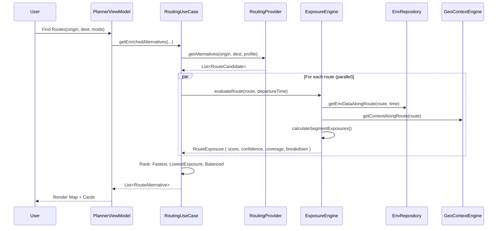

# Routing & Maps — Road Guide

## Overview

Map display, route calculation, and eco-routing comparison for both automatic tracking and manual Eco Route Planner.

**Status**: 📋 Planned — No implementation exists.

---

## Map Stack

| Layer | Technology | Purpose |
|-------|------------|---------|
| **Renderer** | MapLibre Native Android (`org.maplibre.maplibre-android:maplibre`) | Vector tile rendering, GPU accelerated |
| **Tile Source** | OpenFreeMap (Liberty style) | Free OSM-based tiles, no API key |
| **Style** | MapLibre Style JSON (customized Liberty) | Pastel colors, exposure overlays, green areas |
| **Offline** | MapLibre offline manager + MBTiles | Cache tracked areas, private zones |
| **Gestures** | Pan, zoom, rotate, tilt | Standard map interactions |

### Map Style Customization (Per Spec)

**Base Colors** (matching Design System):
| Element | Color | Hex |
|---------|-------|-----|
| Background (land) | Light | #F7F9F7 |
| Water | Soft Blue | #DCECF3 |
| Parks/Green | Light Green | #E7F2EB |
| Major Roads | Muted Gray | #B8C5BC |
| Minor Roads | Light Gray | #E8EDE8 |
| Buildings | Pale | #F0F2F0 |

**Custom Layers** (added to style):
```json
{
  "id": "exposure-heatmap",
  "type": "heatmap",
  "source": "exposure-segments",
  "paint": {
    "heatmap-weight": ["get", "exposureScore"],
    "heatmap-color": [
      "interpolate", ["linear"], ["heatmap-density"],
      0, "rgba(143,201,168,0)",   // Good
      0.3, "rgba(231,209,139,0.6)", // Moderate
      0.6, "rgba(232,167,127,0.7)", // High
      1.0, "rgba(217,135,135,0.8)"  // Very High
    ],
    "heatmap-radius": 30
  }
}
```

---

## Tracker Screen Map Behavior (Per Spec)

```
┌─────────────────────────────────────┐
│ Road Guide             ● Tracking  👤│  ← Top Bar (fixed)
│                                     │
│                                     │
│               MAP                   │  ← Full-screen background
│                                     │
│          Current Location           │
│                                     │
│       Route line / Places           │
│                                     │
│                                     │
│                                     │
├─────────────────────────────────────┤  ← Bottom Sheet (scrollable)
│ Today's Overview                    │
│  8.4 km    5 places    2h 15m       │
│                                     │
│ Daily Exposure                      │
│  42 / 100       Confidence: Medium  │
│  Coverage: 86%                      │
│                                     │
│ [View Timeline] [Daily Report]      │
│                                     │
│ [Map] [Timeline] [Planner] [History]│  ← Bottom Nav
└─────────────────────────────────────┘
```

**Requirements**:
- Map = full screen background (not in scroll view)
- Bottom sheet scrolls **over** map
- Map stays visually fixed during sheet scroll
- Top bar remains accessible
- Current location marker + accuracy circle
- Active route line (polyline) with segment coloring by exposure
- Place markers (Home, Work, custom) with privacy filtering
- "Locate me" button (re-centers + follows)

---

## Coordinate Systems

| System | Use Case | Conversion |
|--------|----------|------------|
| **WGS84 (EPSG:4326)** | GPS, APIs, OSM, MapLibre | Native (lat/lon) |
| **Web Mercator (EPSG:3857)** | MapLibre internal, tile coordinates | `x = lon * 20037508.34 / 180`, `y = ln(tan(π/4 + lat*π/360)) * 20037508.34 / 180` |
| **Local UTM** | Distance calculations (optional) | Per zone; use `haversine` for simplicity |

**Default**: All storage and APIs use **WGS84 decimal degrees**. Distance = haversine formula.

---

## Geocoding (Planned)

| Need | Solution |
|------|----------|
| Place search (Planner origin/dest) | Nominatim (OSM) or Photon (komoot) — free, rate-limited |
| Reverse geocode (Place names) | Same, cached |
| Address display | Structured: street, city, country |

**Nominatim Example**:
```
https://nominatim.openstreetmap.org/search?q=Helsinki&format=json&limit=5&addressdetails=1
```
**Rate Limit**: 1 req/sec; cache results; show attribution.

---

## Routing Engine

### Primary: OSRM

**Self-Hosted Recommended** (public demo unreliable for production).

**Profiles**:
| Profile | Costing | Use Case |
|---------|---------|----------|
| `driving` | Car travel time | Car, Motorcycle |
| `walking` | Pedestrian time | Walking |
| `cycling` | Bicycle time (avoids highways) | Cycling |
| `public_transport` | *Not in OSRM* | Requires Valhalla + GTFS |

**Request**:
```
GET /route/v1/{profile}/{lon1},{lat1};{lon2},{lat2}?alternatives=true&geometries=geojson&overview=full&steps=true&annotations=duration,distance,speed
```

**Response Processing**:
1. Decode polyline → `List<LatLng>`
2. For each alternative → `RouteCandidate`
3. Enrich with environmental + geographic context
4. Calculate Exposure Score per route
5. Sort: Fastest, Lowest Exposure, Balanced

### Alternative: Valhalla

**Advantages**:
- `pedestrian`, `bicycle`, `auto`, `transit` costing
- Turn-by-turn instructions
- Elevation profile
- Isochrones (reachability)
- Custom costing (avoid hills, avoid busy roads)

**Request** (POST):
```json
{
  "locations": [{"lat": 60.1699, "lon": 24.9384}, {"lat": 60.1720, "lon": 24.9450}],
  "costing": "pedestrian",
  "directions_options": {"units": "kilometers"},
  "alternates": 2,
  "shape_match": "map_snap"
}
```

### Routing Abstraction (Repository Pattern)

```kotlin
interface RoutingProvider {
    suspend fun getAlternatives(
        origin: LatLng,
        destination: LatLng,
        waypoints: List<LatLng>,
        profile: RoutingProfile,
        departureTime: Long
    ): Result<List<RouteCandidate>>
    
    enum class RoutingProfile { WALKING, CYCLING, DRIVING, PUBLIC_TRANSPORT }
}

data class RouteCandidate(
    val geometry: List<LatLng>,           // Decoded polyline
    val distanceMeters: Double,
    val durationSeconds: Long,
    val profile: RoutingProfile,
    val steps: List<RouteStep>,
    val provider: String,                 // "OSRM", "Valhalla"
    val rawResponse: String               // For debugging
)

data class RouteStep(
    val instruction: String,
    val distanceMeters: Double,
    val durationSeconds: Long,
    val maneuver: ManeuverType,
    val geometry: List<LatLng>
)
```

---

## Eco Route Planner — Target Architecture

### User Flow
```
Planner Screen
    │
    ├─▶ Origin: [Current Location] / [Search] / [Saved Place]
    ├─▶ Destination: [Search] / [Saved Place]
    ├─▶ Waypoints: [+ Add Stop] (max 5)
    ├─▶ Mode: [Walking] [Cycling] [Driving] [Public Transport*]
    └─▶ [Find Routes]
            │
            ▼
RoutingProvider.getAlternatives()
            │
            ▼
Environmental Enrichment Pipeline (async, parallel per route)
            │
            ▼
ExposureCalculationEngine.evaluateRoute()
            │
            ▼
RouteAlternatives Screen → Map + Comparison Cards
```

### Route Enrichment Pipeline



### Route Exposure Calculation

For each route alternative:
1. **Sample points** every 100–200m along geometry
2. **Time offset** = departureTime + cumulative duration to point
3. **Fetch env data** for (lat, lon, timeOffset)
4. **Fetch geo context** for (lat, lon, radius=100m)
5. **Calculate segment exposure** using same `E = P×T×A×R×W×S`
   - `A` = mode-specific (WALKING=1.0, CYCLING=config, DRIVING=IN_VEHICLE config)
   - `T` = segment duration / 1800
6. **Aggregate** → Route Exposure Score (0–100) + Confidence + Coverage

### Route Comparison Cards (Per Spec)

| Route | Label | Distance | Duration | Exposure Score | Confidence | Coverage | Badge |
|-------|-------|----------|----------|----------------|------------|----------|-------|
| A | Fastest | 4.2 km | 52 min | 68 | High | 90% | ⚡ Fastest |
| B | Balanced | 4.8 km | 58 min | 39 | Medium | 85% | ⚖️ Balanced |
| C | Lowest Exposure | 5.1 km | 64 min | 27 | Medium | 80% | 🌿 Cleanest |

**Balanced Definition**: Minimize `α × duration + β × exposureScore` where `α, β` tuned for ~equal weight.

---

## Map Overlays for Planner

| Overlay | Source | Style |
|---------|--------|-------|
| Route A (selected) | Geometry | Primary green #6FAF8E, width 5, solid |
| Route B | Geometry | Soft blue #DCECF3, width 4, dashed |
| Route C | Geometry | Light gray #E8EDE8, width 3, dotted |
| Origin Marker | User input | Green pin #6FAF8E |
| Destination Marker | User input | Red pin #D98787 |
| Waypoint Markers | User input | Blue pin #5A8FCF |
| Green Areas | Overpass cached | Fill #E7F2EB, opacity 0.6 |
| Major Roads | Overpass cached | Stroke #B8C5BC, width 2 |
| Exposure Heatmap | Calculated | Gradient per design system |

---

## Offline / Caching Strategy

| Data | Cache TTL | Storage |
|------|-----------|---------|
| Map Tiles | MapLibre default (LRU) | Internal cache dir |
| Route Geometries | 24 hours | Room (`cached_routes` table) |
| Enriched Route Exposure | 1 hour | Memory + Room |
| Geocoding Results | 30 days | Room (`geocode_cache`) |
| OSM Context (Overpass) | 24 hours | Room (`osm_context_cache`) |

---

## Limitations & Constraints

| Limitation | Impact | Mitigation |
|------------|--------|------------|
| OSRM public demo: rate limited, no SLA | Unreliable for production | Self-host OSRM or use Valhalla |
| OSRM: no public transit | Planner can't do transit | Valhalla + GTFS (future) |
| Valhalla public: rate limited | Same | Self-host |
| Free tiles: no SLA | Map may fail | Cache aggressively; fallback style |
| Routing ≠ Navigation | No turn-by-turn guidance | "Start Navigation" → external app intent |
| Exposure model resolution | ~11–45 km grid | Show Confidence/Coverage honestly |

---

## Planned vs Implemented

> **All routing and map components are 📋 Planned** — no MapLibre integration, no routing client, no planner UI exists.
> This document defines target architecture per `ROAD GUIDE.txt` (Parts 12, 15, 16, 22).