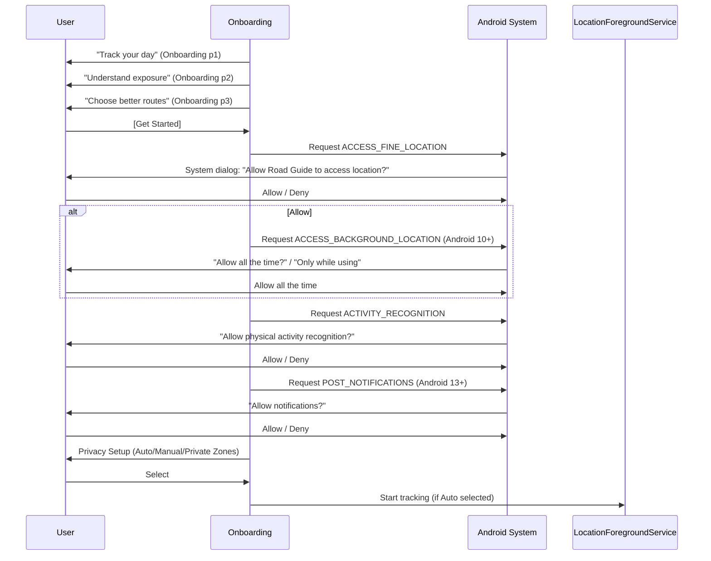

# Background Services & Permissions — Road Guide

## Overview

Foreground Service architecture, Android permission model, battery optimization, and privacy controls for continuous location tracking.

**Status**: 📋 Planned — No implementation exists.

---

## Foreground Service: LocationForegroundService

### Manifest Declaration

```xml
<service
    android:name=".service.LocationForegroundService"
    android:foregroundServiceType="location"
    android:exported="false"
    android:stopWithTask="false" />

<!-- Permissions -->
<uses-permission android:name="android.permission.FOREGROUND_SERVICE" />
<uses-permission android:name="android.permission.FOREGROUND_SERVICE_LOCATION" />
<uses-permission android:name="android.permission.ACCESS_FINE_LOCATION" />
<uses-permission android:name="android.permission.ACCESS_COARSE_LOCATION" />
<uses-permission android:name="android.permission.ACCESS_BACKGROUND_LOCATION" />
<uses-permission android:name="android.permission.ACTIVITY_RECOGNITION" />
<uses-permission android:name="android.permission.POST_NOTIFICATIONS" />
<uses-permission android:name="android.permission.RECEIVE_BOOT_COMPLETED" />
<uses-permission android:name="android.permission.SCHEDULE_EXACT_ALARM" />  <!-- Android 14+ for restart -->
<uses-permission android:name="android.permission.USE_EXACT_ALARM" />
```

### Service Implementation

```kotlin
class LocationForegroundService : Service(), LifecycleOwner {
    private val fusedLocationClient by lazy { LocationServices.getFusedLocationProviderClient(this) }
    private val locationRequest by lazy { createLocationRequest() }
    private val locationCallback = object : LocationCallback() {
        override fun onLocationResult(result: LocationResult) {
            handleLocationResult(result.lastLocation)
        }
    }
    private var currentNotificationId = NOTIFICATION_ID_TRACKING
    private var trackingState: TrackingState = TrackingState.IDLE
    
    override fun onStartCommand(intent: Intent?, flags: Int, startId: Int): Int {
        val action = intent?.action ?: ACTION_START_TRACKING
        when (action) {
            ACTION_START_TRACKING -> startTracking()
            ACTION_PAUSE_TRACKING -> pauseTracking()
            ACTION_RESUME_TRACKING -> resumeTracking()
            ACTION_STOP_TRACKING -> stopTracking()
            ACTION_UPDATE_INTERVAL -> updateInterval(intent.getIntExtra(EXTRA_INTERVAL_MS, DEFAULT_INTERVAL_MS))
        }
        return START_STICKY  // Restart if killed
    }
    
    private fun startTracking() {
        // 1. Check permissions
        if (!hasLocationPermissions()) {
            stopSelf()
            return
        }
        
        // 2. Create notification channel (Android 8+)
        createNotificationChannel()
        
        // 3. Build initial notification
        val notification = buildTrackingNotification(TrackingStatus.ACTIVE)
        
        // 4. Start foreground with location type
        if (Build.VERSION.SDK_INT >= Build.VERSION_CODES.Q) {
            startForeground(NOTIFICATION_ID_TRACKING, notification, FOREGROUND_SERVICE_TYPE_LOCATION)
        } else {
            startForeground(NOTIFICATION_ID_TRACKING, notification)
        }
        
        // 5. Request location updates
        requestLocationUpdates()
        
        // 6. Notify MovementEngine that tracking started
        EventBus.post(TrackingStartedEvent())
    }
    
    private fun requestLocationUpdates() {
        val request = locationRequestBuilder.build()
        fusedLocationClient.requestLocationUpdates(
            request,
            locationCallback,
            Looper.getMainLooper()
        )
    }
}
```

### Adaptive LocationRequest Builder

```kotlin
private fun createLocationRequest(): LocationRequest.Builder {
    return LocationRequest.Builder(Priority.PRIORITY_BALANCED_POWER_ACCURACY)
        .setIntervalMillis(DEFAULT_INTERVAL_MS)           // 10 sec default
        .setMaxUpdateDelayMillis(MAX_WAIT_MS)             // 30 sec batching
        .setMinUpdateIntervalMillis(MIN_INTERVAL_MS)      // 5 sec floor
        .setMaxUpdates(Int.MAX_VALUE)
        .setGranularity(Granularity.GRANULARITY_FINE)
}
```

**Interval Adjustment API** (called by MovementEngine via intent):
```kotlin
private fun updateInterval(intervalMs: Long) {
    val request = LocationRequest.Builder(Priority.PRIORITY_BALANCED_POWER_ACCURACY)
        .setIntervalMillis(intervalMs)
        .setMaxUpdateDelayMillis(intervalMs * 3)
        .setMinUpdateIntervalMillis(min(intervalMs / 2, 5000))
        .build()
    fusedLocationClient.requestLocationUpdates(request, locationCallback, Looper.getMainLooper())
}
```

---

## Notification Design

### Channels

| Channel ID | Name | Importance | Description |
|------------|------|------------|-------------|
| `tracking` | Location Tracking | HIGH | Ongoing tracking status (foreground service) |
| `daily_report` | Daily Reports | DEFAULT | End-of-day report ready |
| `warnings` | Data Warnings | HIGH | GPS lost, permission issues, API failures |
| `suggestions` | Route Suggestions | LOW | Eco-route recommendations |

### Tracking Notification (Ongoing)

```xml
<!-- Layout: notification_tracking.xml -->
<LinearLayout>
    <ImageView android:src="@drawable/ic_location_on" />
    <TextView android:text="Road Guide is tracking" />
    <TextView android:text="Today: 8.4 km • 5 places • 42/100" />
    <ProgressBar style="horizontal" />  <!-- Daily progress -->
    <Button android:text="Pause" />      // Action: PAUSE_TRACKING
    <Button android:text="Report" />     // Action: OPEN_DAILY_REPORT
</LinearLayout>
```

**Actions** (PendingIntents):
- `PAUSE_TRACKING` → `LocationForegroundService#pauseTracking()`
- `OPEN_DAILY_REPORT` → `MainActivity` deep link `roadguide://report?date=today`
- `OPEN_APP` → `MainActivity` (tap notification body)

### Notification Updates

| Trigger | Update |
|---------|--------|
| New location point | Update distance/places in text (throttled: max 1/min) |
| Exposure score change | Update score badge |
| Tracking paused | Change to "Paused" notification (lower priority) |
| Daily report ready | Separate `daily_report` notification |
| Permission needed | `warnings` channel: "Location permission required" |

---

## Permission Flow (Per Spec Part 16)

### Request Sequence



### Permission Rationale Screens (Before System Dialog)

| Permission | Screen Title | Key Message |
|------------|--------------|-------------|
| `ACCESS_FINE_LOCATION` | "Location Access" | "Road Guide uses your location to record daily movements, recognize visited places and estimate environmental conditions along your day." |
| `ACCESS_BACKGROUND_LOCATION` | "Background Tracking" | "To build your daily timeline, Road Guide needs to continue tracking when the app is not open." + Show notification preview + Timeline example |
| `ACTIVITY_RECOGNITION` | "Movement Detection" | "Road Guide uses movement signals to distinguish walking, cycling, driving and stationary periods." |
| `POST_NOTIFICATIONS` | "Notifications" | "Notifications show tracking status, let you pause monitoring, and deliver your daily environmental report." |

**Rule**: Never call system permission dialog without showing rationale screen first.

---

## Battery Optimization

### Doze Mode & App Standby

| Strategy | Implementation |
|----------|----------------|
| **Foreground Service** | `startForeground(..., FOREGROUND_SERVICE_TYPE_LOCATION)` — exempt from Doze |
| **Battery Optimization** | Guide user to "Unrestricted" via `ACTION_REQUEST_IGNORE_BATTERY_OPTIMIZATIONS` |
| **Adaptive Intervals** | Reduce frequency when stationary (see `04_GPS_AND_TRACKING.md`) |
| **Batching** | `setMaxUpdateDelayMillis()` > interval for WiFi/cell batching |
| **Passive Updates** | `PRIORITY_PASSIVE` when other apps request location |

### Battery Diagnostics (Settings → Tracking Diagnostics)

```kotlin
data class BatteryDiagnostics(
    val trackingHours: Double,
    val batteryPercentUsed: Double,
    val avgPercentPerHour: Double,
    val locationUpdatesCount: Long,
    val avgIntervalMs: Long,
    val wakeLockDurationMs: Long,
    val lastReset: Instant
)
```
- Reset on app version change or user action
- Display in Settings for transparency

---

## Process Death & Recovery

### Scenarios

| Scenario | Recovery Mechanism |
|----------|-------------------|
| **User swipes app from recents** | `START_STICKY` → service recreated → `onStartCommand(null, 0, 0)` → resume tracking |
| **OS kills for memory** | Same as above; `LocationForegroundService` restarts |
| **Phone reboot** | `BootReceiver` → check `Settings.trackingEnabled` → start service |
| **Permission revoked** | `PermissionChangeReceiver` → stop service, show warning |
| **GPS disabled** | `LocationProviderChangeReceiver` → pause updates, show banner |

### BootReceiver

```kotlin
class BootReceiver : BroadcastReceiver() {
    override fun onReceive(context: Context, intent: Intent) {
        if (intent.action == Intent.ACTION_BOOT_COMPLETED ||
            intent.action == Intent.ACTION_LOCKED_BOOT_COMPLETED) {
            
            val prefs = DataStorePrefs(context)
            if (prefs.getBoolean(TRACKING_ENABLED_KEY, false)) {
                val startIntent = Intent(context, LocationForegroundService::class.java)
                    .setAction(LocationForegroundService.ACTION_START_TRACKING)
                if (Build.VERSION.SDK_INT >= Build.VERSION_CODES.O) {
                    context.startForegroundService(startIntent)
                } else {
                    context.startService(startIntent)
                }
            }
        }
    }
}
```

### Exact Alarm for Restart (Android 14+)

```kotlin
// Schedule periodic health check if service dies unexpectedly
fun scheduleHealthCheck(context: Context) {
    val alarmManager = context.getSystemService(ALARM_SERVICE) as AlarmManager
    val intent = Intent(context, HealthCheckReceiver::class.java)
    val pendingIntent = PendingIntent.getBroadcast(
        context, 0, intent, PendingIntent.FLAG_IMMUTABLE
    )
    alarmManager.setExactAndAllowWhileIdle(
        AlarmManager.RTC_WAKEUP,
        System.currentTimeMillis() + HEALTH_CHECK_INTERVAL_MS,
        pendingIntent
    )
}
```

---

## Private Zones (Geofencing)

### Implementation

```kotlin
class PrivateZoneManager(private val context: Context) {
    private val geofencingClient = LocationServices.getGeofencingClient(context)
    private val zoneDao = RoomDb.getInstance(context).privacyZoneDao()
    
    fun addZone(zone: PrivacyZone) {
        zoneDao.insert(zone)
        registerGeofence(zone)
    }
    
    private fun registerGeofence(zone: PrivacyZone) {
        val geofence = Geofence.Builder()
            .setRequestId(zone.id.toString())
            .setCircularRegion(zone.center.latitude, zone.center.longitude, zone.radiusMeters)
            .setTransitionTypes(Geofence.GEOFENCE_TRANSITION_ENTER or Geofence.GEOFENCE_TRANSITION_EXIT)
            .setExpirationDuration(Geofence.NEVER_EXPIRE)
            .build()
        
        val request = GeofencingRequest.Builder()
            .setInitialTrigger(GeofencingRequest.INITIAL_TRIGGER_ENTER)
            .addGeofence(geofence)
            .build()
        
        geofencingClient.addGeofences(request, createPendingIntent())
    }
    
    // In GeofenceBroadcastReceiver:
    // On ENTER: set flag in LocationPoint.qualityFlags |= PRIVATE_ZONE_BIT
    // On EXIT: clear flag
}
```

### Data Handling in Private Zones

| Data | Behavior |
|------|----------|
| LocationPoint | Stored with `PRIVATE_ZONE` quality flag |
| Stay | `privacyStatus = EXCLUDED` |
| Timeline | Shows "Private Zone" placeholder, no coordinates/name |
| Exposure | Optional exclusion (user setting) |
| Export/Delete | Separate "Delete Private Zone Data" action |

---

## Privacy Controls (Per Spec Part 14)

| Control | Implementation |
|---------|----------------|
| **Local Storage Default** | Room DB only; no network sync unless user enables |
| **No Third-Party Tracking** | No analytics SDK; no crash reporting to external services (v1) |
| **Pause Monitoring** | `LocationForegroundService#pauseTracking()` → `removeLocationUpdates()` |
| **Private Zones** | Geofences + data filtering (above) |
| **Delete Daily History** | `RouteRepository.deleteByDate(date)` + cascades |
| **Delete All Data** | `RoomDatabase.clearAllTables()` + DataStore clear |
| **Export Data** | JSON export (see `09_API_AND_DATA_CONTRACTS.md`) |
| **No Mandatory Auth** | All core features work offline, no account |

---

## Testing Checklist

| Test | Expected Behavior |
|------|-------------------|
| Start tracking → swipe app from recents | Service continues, notification persists |
| Reboot phone → unlock → wait 30s | Service restarts, tracking resumes |
| Revoke location permission mid-tracking | Service stops, UI shows permission banner |
| Enable battery saver → track 1 hour | Service survives, intervals may increase |
| Enter private zone → check Timeline | "Private Zone" placeholder, no details |
| Pause tracking → resume after 2 hours | Continuous route (no gap) or new route (configurable) |
| GPS off → on → move | Service resumes updates automatically |
| Network off → track → network on | Env data fetched retroactively for tracked points |

---

## Planned vs Implemented

> **All background service and permission components are 📋 Planned** — no Foreground Service, no permission flow, no geofencing exists.
> This document defines target behavior per `ROAD GUIDE.txt` (Parts 5, 14, 16, 27, 28, 30).